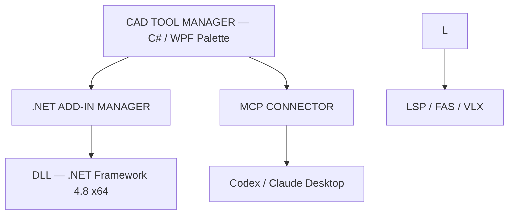

# CAD Tool Manager — AutoCAD 2021

Gõ `AICADTOOLS` trong phiên AutoCAD đã nạp plugin AI CAD. `Mo AI CAD.cmd` chọn bản plugin mới nhất đã build và mở một DWG mới nếu phiên đang mở dùng phiên bản cũ.

## Dùng trong AutoCAD

- `AICADADDINS`: mở tab .NET.
- `AICADMCP`: mở tab MCP Connector.
- **Thêm file**: sao chép công cụ vào kho; chưa nạp hoặc chạy mã.
- **Cập nhật file**: tạo gói mới, giữ ID, tên, nhóm, ghi chú; giữ gói cũ để đối chiếu.
- **Lưu hồ sơ**: lưu tên, nhóm, công dụng/ghi chú, và bật/tắt.
- **Nạp / nạp lại** và **Chạy lệnh**: chạy tại DWG đang chọn, khi AutoCAD không bận lệnh khác. Nếu đổi DWG hoặc gói công cụ trong lúc chờ, yêu cầu bị từ chối.
- **Xóa / khôi phục**: chuyển mục vào/ra thùng rác, không xóa payload. Không có tự nạp khi khởi động.

Danh mục ở `<Kho>/Tools/catalog.json`; payload được lưu theo ID và checksum bằng đường dẫn tương đối. Khi dùng trên hai máy, đồng bộ toàn bộ `Tools` cùng kho. Cache DLL và nhật ký chạy nằm trong DataRoot của từng máy.

## .NET add-in

Chọn DLL .NET Framework 4.8 x64 tương thích AutoCAD 2021. Nhập DLL cùng các dependency DLL/PDB nằm cạnh nó; không sao chép các DLL API AutoCAD hoặc lõi AI CAD. Nên đặt riêng từng công cụ trong một thư mục trước khi nhập.

Manager nạp bản sao vào cache, dò các `CommandMethod` public trả về `void`, không có tham số và có thể khởi tạo class. Hỗ trợ method static/instance, phân biệt command document với `CommandFlags.Session`. Các implementation `IExtensionApplication` được khởi tạo khi nạp; bản cũ được gọi `Terminate` khi nạp lại.

Danh sách lệnh tìm được được lưu vào hồ sơ để MCP tra cứu. Không thực thi `.cs` trực tiếp: biên dịch thành DLL trước. Add-in phụ thuộc cơ chế đăng kí riêng của NETLOAD hoặc command flags đặc biệt cần kiểm tra riêng.

CLR .NET Framework trong AutoCAD 2021 không gỡ riêng từng assembly. Nạp lại DLL chính dùng shadow copy; đổi dependency đã nạp với cùng assembly identity sẽ yêu cầu mở lại CAD. Xóa/tắt hồ sơ chặn các lần gọi tiếp từ Manager, không tương đương unload assembly hay hoàn tác thay đổi do công cụ đã chạy.

## Ribbon Rainmaker

Plugin 0.7.8 thêm tab **Rainmaker** trên Ribbon AutoCAD 2021. Gõ `RIBBON` để hiện thanh Ribbon nếu đang ẩn. Nếu AutoCAD đang chạy với plugin cũ, lưu DWG rồi mở lại AutoCAD để tự nạp bản mới.

Từ 0.7.12, **Tạo trục** được đóng gói riêng trong `Rainmaker.Axis.dll` và dùng thư viện CAD của plugin AI CAD. Trong **.NET Add-in**, phần **File nguồn và SHA256** hiển thị đường dẫn DLL trong kho. Dùng **Vị trí file**, **Cập nhật file** hoặc **Xóa khỏi danh mục** như với các add-in khác.

- **Trục & cao độ → Tạo trục** (`RAINMAKERAXIS`). Trong Model với đơn vị mm, chọn hai đầu trục rồi nhập ký hiệu và mẫu số tỷ lệ. Đường trục dùng layer `QA_KT_Truc`. Hai đầu dùng block ATT `QA_ATT_TRUC` trên layer `QA_KH_Truc Dinh Vi` của Template Quang Anh đang hoạt động.
- **Quản lý → CAD Tool Manager** mở danh mục .NET. Để thêm nút, chọn **Thêm file** hoặc **Cập nhật file**, rồi **Nạp / nạp lại**, chọn lệnh và mở **Ribbon Rainmaker** trong hồ sơ. Bật **Ghim lệnh đã chọn** và **Lưu nút Ribbon** sau khi điền nhãn, nhóm, công dụng, biểu tượng và thứ tự.
- Cấu hình nút lưu chung với danh mục trong kho. Khi cập nhật DLL, nút của những lệnh còn tồn tại được giữ lại. Tải lại danh sách lệnh để ghim lệnh mới. Nút chạy trên DWG đang mở và sẽ nạp gói trong phiên khi cần.

## MCP Connector

Tab MCP cung cấp cấu hình Claude Desktop JSON và Codex TOML theo đường dẫn cài đặt hiện tại; chọn client rồi **Sao chép cấu hình** để gộp vào cấu hình của client. Không ghi đè cấu hình client hoặc xử lí tài khoản. Sau khi đổi cấu hình, kết nối lại MCP phía client.

Server stdio vẫn là `MCP.Server` hiện có. Tool mới `list_cad_utilities` chỉ đọc danh mục đang hoạt động, công dụng, trạng thái, lệnh và đường dẫn. Các tool lập kế hoạch/xem trước và việc duyệt ghi DWG hiện có vẫn giữ nguyên; MCP không có endpoint chạy DLL tùy ý.

Chạy server thủ công: `tools/Start-Mcp.ps1 -Release p0-p6`.

## Kiểm tra

- `tests/ToolManager.Tests`: nhập DLL, metadata, đường dẫn tương đối, lịch sử gói, thùng rác, cạnh tranh cập nhật, kiểm tra toàn vẹn và cấu hình MCP.
- `tests/ToolManager.Fixture` + `AICADTOOLSTEST` trong Core Console: dò lệnh DLL, chạy V1 rồi nạp/chạy V2 không khởi động lại, kiểm tra DLL nguồn không bị khóa. Chỉ chạy trong thư mục test có marker `.aicad-tools-test`.
- Nguồn tham khảo và giấy phép: [TOOL-MANAGER-SOURCES.md](../third_party/TOOL-MANAGER-SOURCES.md).

## Giao diện dark mode 0.7.2

Palette dùng theme tối riêng cho hai tab .NET Add-in và MCP; không thay đổi theme của các cửa sổ AutoCAD khác. Danh sách và bộ lọc ở phía trên, hồ sơ chỉ hiện khi chọn công cụ, nút nạp/chạy giữ ở cuối pane. File nguồn/SHA256 và phần thiết lập nâng cao nằm trong mục có thể mở rộng. Khi palette hẹp, phần hồ sơ cuộn riêng để giữ các thao tác chạy luôn nhìn thấy.

Theme WPF áp dụng cho bảng, ô nhập, menu chọn, checkbox, thanh cuộn, tab, nút, trạng thái focus và disabled. Đã render thử 420×640, 620×860, 900×900; màu chữ thường đạt tương phản trên 4.5:1. Plugin 0.7.2 được nạp ở phiên AutoCAD mới khi mở `Mo AI CAD.cmd`; gõ `AICADTOOLS` để mở palette.
